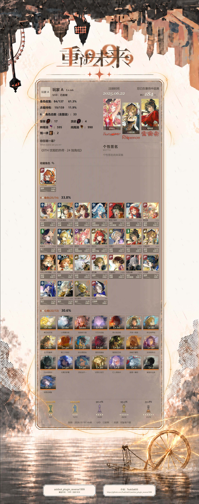

# Box 从静态原型到真实账号展示

当前里程碑为0.8.0。TsukiSa835负责需求、架构方向、核心业务与布局规则设计，并以本人官服账号参与登录、手机在线冲突与结果核对验收。
## 两条主线与汇合

两条主线分别是静态Box规划与渲染、动态玩家数据获取。静态线建立公共素材索引、角色/皮肤/心相映射、统计语义、统一模板与可变长背景；动态线通过官服授权会话独立读取玩家实际状态，不依赖TapTap。两者现已在独立验证目录汇合，完成同一账号真实快照到Box图片的闭环，正式Bot接入仍待完成。

## 静态原型迭代

|阶段|维护者提出并确定的关键设计|结果|
|---|---|---|
|早期至v2|七列长图、真实角色素材、收藏优先|建立卡片与背景基线，玩家状态为模拟|
|v3—v4|A/B养成底框比较、心相贴右下角、细雨与金色质感|确定信息密度与主次层次|
|v5—v6|以数字加星表示标题星级；棋子以重复星和收集比例展示|收集率与角色状态分开表达|
|v7—v8|双生舞伶双灵感斜切、收藏回形针、满收集保留黑边|修正特殊角色和状态视觉语义|
|v9—v10|确定A版养成底框、采用当前装备皮肤、角色签名、含塑造份数|明确数据含义与展示优先级|
|v11—v13|签名按实际笔迹放大、三角色两侧对齐中间下沉、薄斜杠占位、纺轮参照实图|形成整体视觉基线|
|真实数据适配阶段|修复旧心相目录、统一等级/信任度换算、动态延长背景|完成本人账号真实Box展示|
|2026-10-19收尾|衣着只留总览、角色收集名称、50字个性签名留位、双语标签、注册与累计布局、底部来源/作者信息|默认Box展示稿定稿；品质明细留给独立皮肤Box|

原型的index-v2至index-v13与真实数据适配稿的player-box-v系列属于不同阶段编号，不等同插件版本；后者部分文件是最新输出别名，不作为不可变历史版本。历史结论以阶段报告和快照时间为准。

## 核心规则与算法

- **静态目录与玩家状态分离**：公共配置决定ID、品质、图标；同一次授权快照决定持有、养成、当前皮肤与数量。未知、未装备、0和空列表分别处理。
- **收藏统计**：按维护者确认的国服资源目录口径计算；排除材料、测试、剧情/占位及未确认图片。六星角色份数为Σ(1+塑造等级)；心相按类型ID统计种数，逐份记录保留，不按名称合并。
- **皮肤语义**：默认、洞悉、往日衣着不计默认Box；活动、兑换码、联动和付费衣着只要明确拥有就计数。往日衣着保留给主页功能。品质采用skinLevel，获取途径与品质独立。
- **字段适配**：将内部累计等级和洞悉编码转换为展示等级；依据固定客户端阈值转换信任度，按角色模板关联调频。角色心相偏好不扩写为编队装备。
- **可变长图**：固定顶部/底部原画尺寸，独立中间纸面、框线和雨丝层，按内容高度计算扩展量。底部棋子/快照围绕框底定位，避免拉长装饰；雨丝位置不规则、方向一致。
- **确定性渲染**：数据→ID选图→固定HTML/CSS模板→浏览器排版→PNG。固定种子装饰使相同输入可复现，无需大模型参与每次出图。
- **版本与纠错**：公开配置和图片固定各自提交，校验后切换版本；失败保留旧版。疑似废案另存原图、路径和哈希，不删除源文件。公共素材更新不会被当成玩家刷新。

## 当前本人快照成果

采集时间2026-10-18 14:48（北京时间）：84位角色、672条含材料仓库记录；其中25位六星角色、22种六星心相、六星角色含塑造33份。当前目录角色137、六星角色74、六星普通心相72；衣着19/159。数字来自特定快照和本项目目录，不是官方实时可获取池。

旧心相定义从33条补全至135条：普通心相125、增幅材料2、经验材料5、测试条目3；26张缺完整定义的图保留待确认。维护者识别1409与1413、1412与1414的高度相似关系，仅标疑似旧版，不合并ID。28款皮肤的额外获取编码已全部对应活动ID。29张敌人图另记，不作未上架判断。

## 验证与限制

独立工具29项数据测试通过；浏览器检查图片完整性、实际装备ID、卡片数量、字体/间距、50字签名、540px窄屏，以及增加1/3组卡片时顶部407、底部385尺寸不变。验证摘要见[脱敏证据](evidence/box-milestone-0.8.0.json)。

本轮仍是同一旧快照重绘。个性签名正文待下次采集；跨刷新实例ID稳定性、授权长期保存/期限尚未完成。正式QQ刷新、互斥、缓存提交和图片发送未接入。不能以离线测试推断线上收发已成功。
